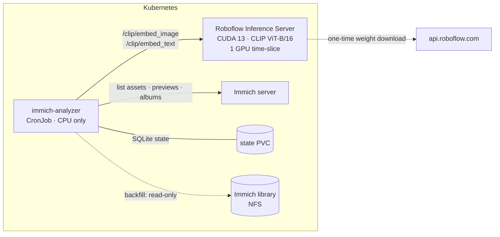

# roboflow-immich-analyzer

[](https://github.com/pedrotchang/roboflow-immich-analyzer/actions/workflows/ci.yml)

Sort a self-hosted [Immich](https://immich.app) photo library into three review
albums using a **self-hosted [Roboflow Inference](https://github.com/roboflow/inference)
server running CLIP on a local NVIDIA GPU**:

| Album | What lands there | How it's decided |
|---|---|---|
| **Receipts** | Photos of receipts and bills | CLIP zero-shot (prompt ensemble) |
| **Screenshots** | Phone and desktop screenshots | Filename/EXIF prior + CLIP zero-shot |
| **Safe to Delete** | Blurry shots and near-duplicate extras | Laplacian-variance focus measure + CLIP, and CLIP-embedding similarity inside a time window |

It never deletes, edits or moves anything. It only **adds assets to albums**, so a
person reviews each album and deletes what they agree with. Favorites never go into
*Safe to Delete*. If you take an asset out of an album, it is not added back.

Photos stay on your hardware. Inference runs on your GPU, and the Roboflow API is only
called once, to download the CLIP weights.

## Architecture



**One GPU pass per photo.** Each preview gets a single CLIP image embedding. The same
vector is used three times:

1. **Classification.** The text prompts for each class are embedded once per run.
   Each image's class scores are a softmax over its cosine similarity to the
   class-mean text embeddings. No training is needed.
2. **Duplicate detection.** Photos taken within `DUPLICATE_WINDOW_S` of each other
   with cosine similarity of at least `DUPLICATE_COSINE` are grouped with union-find.
   The group keeps its best photo (favorite, then sharpest, then largest) and the
   rest go to *Safe to Delete*. The time window keeps this close to O(n) and avoids
   matching "two beach photos from different years".
3. **Future uploads.** Embeddings are stored, so new photos are checked against
   their neighbours in time without re-embedding anything.

**Blur** combines a classic signal with a learned one. The variance of the Laplacian
on a fixed 512px grayscale image is the focus measure. Very low values count as blurry
on their own. Borderline values also need CLIP to agree ("a blurry photo" vs "a sharp
photo"), which keeps intentional bokeh out. Documents and screenshots are never judged
for blur.

### Run modes

| Mode | When | Pixels come from | Assets |
|---|---|---|---|
| `backfill` | First run (no watermark in the state DB) | Immich preview JPEGs read straight off a **read-only NFS mount** (no load on the Immich server) | Whole library |
| `incremental` | Every later run | `GET /api/assets/{id}/thumbnail` over the **Immich API** | `createdAt > watermark` |

`--mode auto` (the default) picks the mode for you. Runs are idempotent and
resumable: if a backfill crashes, the next run skips work that's already done.
Immich generates previews asynchronously, so the watermark never moves past an asset
whose preview doesn't exist yet. That asset is retried on the next run.

## Running it

### Prerequisites

- Immich **v3.2+**, plus one API key per user whose library you want triaged.
  Permissions: `user.read asset.read asset.view album.read album.create albumAsset.create`
- A Roboflow Inference server with CLIP enabled. On Blackwell GPUs (RTX 50xx), use
  `roboflow/roboflow-inference-server-gpu-cu13`; the default `-gpu` image is
  built against CUDA 12.4.
- A [Roboflow API key](https://app.roboflow.com/settings/api), used by the
  inference server to fetch weights.

### Configuration

| Variable | Default | |
|---|---|---|
| `IMMICH_URL` | `http://immich-server.immich:2283` | |
| `IMMICH_API_KEYS` | (required) | Comma-separated; one per user |
| `INFERENCE_URL` | `http://roboflow-inference:9001` | |
| `LIBRARY_ROOT` | unset | Mount of Immich's upload dir; enables fast NFS backfill |
| `STATE_PATH` | `/state/analyzer.sqlite3` | |
| `BATCH_SIZE` / `CONCURRENCY` | `8` / `4` | Images per request / requests in flight |
| `DRY_RUN` | `false` | Classify and store, but don't touch albums or the watermark |
| `RECEIPT_PROB` / `SCREENSHOT_PROB` | `0.60` | Zero-shot probability thresholds |
| `BLUR_HARD` / `BLUR_SOFT` / `BLUR_CLIP_PROB` | `15` / `60` / `0.50` | |
| `DUPLICATE_COSINE` / `DUPLICATE_WINDOW_S` | `0.95` / `120` | |
| `ALBUM_RECEIPTS` / `ALBUM_SCREENSHOTS` / `ALBUM_SAFE_TO_DELETE` | `Receipts` / `Screenshots` / `Safe to Delete` | |

### Commands

```console
$ immich-analyzer check     # connectivity to Immich (per key) and the inference server
$ immich-analyzer run       # analyse + sync albums (auto backfill/incremental)
$ immich-analyzer report    # label counts and sample reasons from the state DB
```

Logs are one JSON object per line, ready for Loki or Elasticsearch:

```json
{"ts": "2026-10-26T21:14:03", "level": "info", "msg": "progress", "analyzed": 41216, "total": 98012, "per_second": 37.9, "eta_min": 25.0}
```

### Kubernetes

[`deploy/`](deploy/) has a self-contained Kustomize example: the inference Deployment,
the analyzer CronJob, NetworkPolicies, and PVCs. The production manifests for the
author's homelab (Flux, Cilium FQDN egress policies, External Secrets from Azure Key
Vault) are in
[`gitops-platform`](https://forgejo.seyzahl.com/platform-infrastructure/gitops-platform/src/branch/main/apps/base/roboflow-immich-analyzer).

## Security and operations notes

- **Least privilege at every layer.** The Immich API key can read and add to albums,
  but can't delete or modify assets. The library mount is read-only at the NFS
  export, the PV and the volumeMount. Containers run non-root with all capabilities
  dropped, and the analyzer also has a read-only root filesystem.
- **Smaller attack surface on the inference server.** Workflows, custom Python
  execution, the stream API, the builder UI, and every core model except CLIP are
  disabled.
- **Privacy.** Roboflow Model Monitoring (`METRICS_ENABLED`) and the version check are
  off. Egress from the inference pod is limited by FQDN policy to Roboflow's weight
  hosts, and the analyzer can only reach Immich and the inference service.
- **GPU sharing.** The inference server takes one NVIDIA time-slice and uses a
  `Recreate` rollout. The analyzer itself needs no GPU and runs anywhere.
- **Supply chain.** Base images are pinned by digest, dependencies are locked with
  `uv.lock`, and CI actions are pinned to commit SHAs (kept current by Renovate).
  The GitHub mirror builds the image and scans it with Trivy on every push.
  Results go to code scanning, and fixable CRITICAL findings fail the build.

## Where the code lives

This repo is canonical on a self-hosted
[Forgejo](https://forgejo.seyzahl.com/platform-infrastructure/roboflow-immich-analyzer)
and push-mirrored to [GitHub](https://github.com/pedrotchang/roboflow-immich-analyzer).
Forgejo Actions builds and publishes the image the cluster runs. GitHub Actions
runs the same tests, plus a container build and vulnerability scan.

## Development

```console
$ uv sync
$ uv run pytest          # unit + end-to-end tests against fake Immich/Inference servers
$ uv run ruff check . && uv run ruff format --check .
```

The end-to-end tests run the real HTTP clients against in-process fakes of the
Immich and Roboflow APIs (`httpx.MockTransport`). They cover backfill, incremental
runs, missing previews, duplicate grouping, favorites, dry-run, and respecting a
user's manual album removals.

## License

MIT
